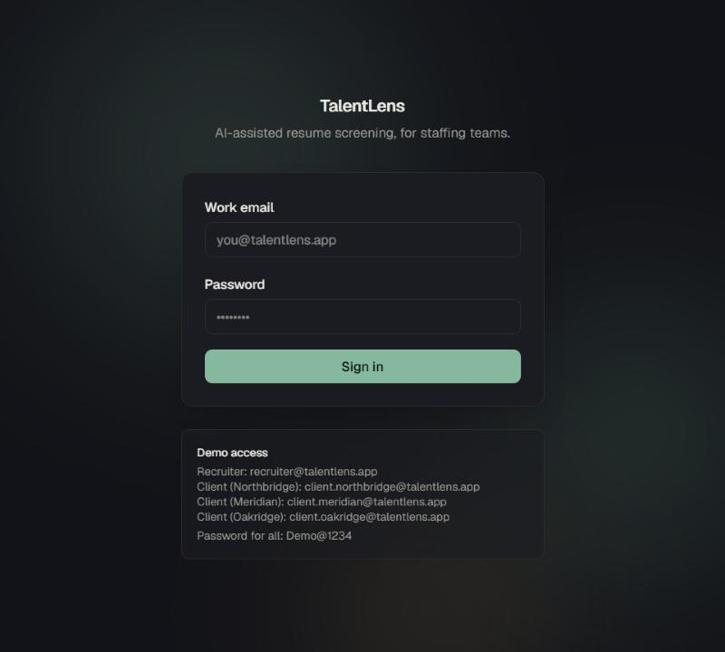
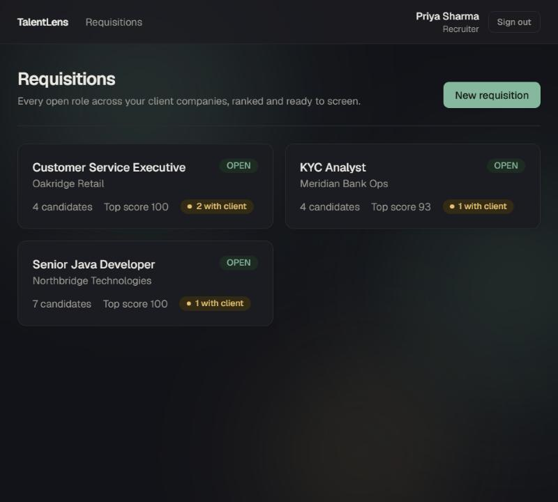
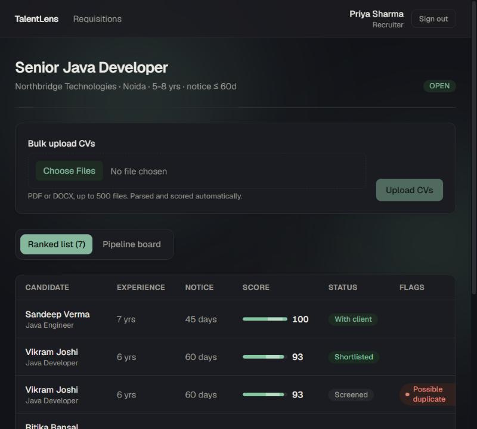
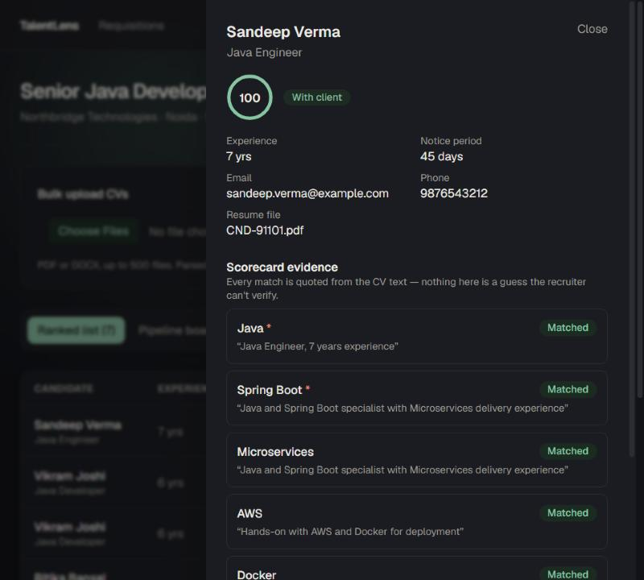
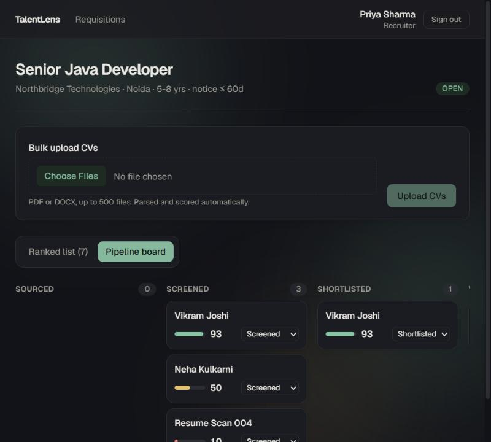
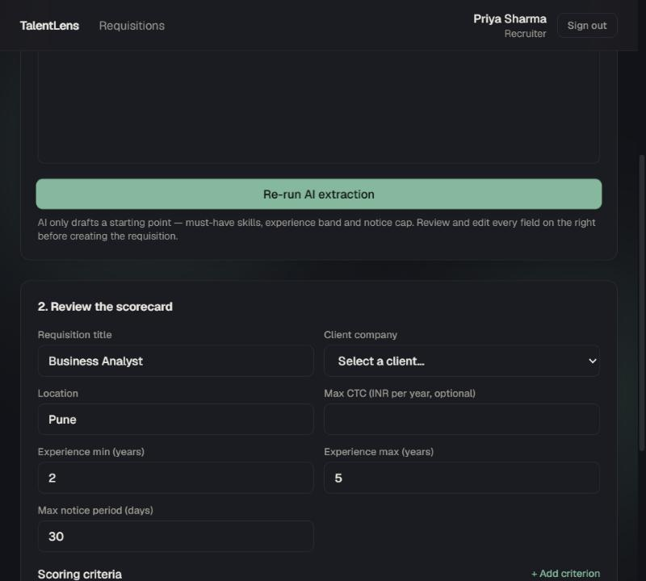
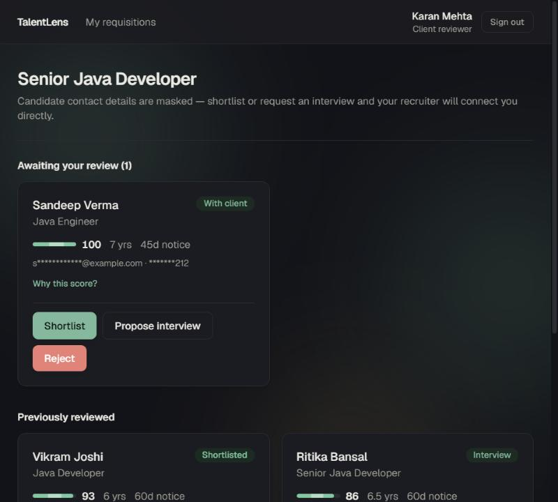

# Technical Design Document

### TalentLens: an AI resume screening and client shortlist portal

**GitHub:** [not pushed yet — pushed by the candidate before final submission]
**Live app:** https://talentlens-pink.vercel.app — deployed on Vercel (free Hobby plan) with Prisma Postgres (free tier). Demo logins are in `deployment.md`.
**Problem statement chosen:** Staffing firm's AI resume screening tool and client shortlist portal (Company A, Noida)
**Role in the build:** solo, Software Engineering core build. Date: 9 November 2026

## 1. Summary

The brief's own estimate: Company A loses about **Rs. 1.57 crore a year** — Rs. 75.6 lakh in recruiter hours reading CVs that were never going to fit, and Rs. 81 lakh in requisitions lost to faster rivals because shortlists take 5 days. I built the core slice the brief names, end to end, plus a few extras that serve the same goal:

- **Recruiter side:** paste a JD, AI drafts an editable scorecard (must-have skills, experience band, notice cap); bulk-upload CVs (PDF/DOCX, up to 500) parsed and scored automatically; a ranked list where every match **quotes the exact line of the CV** it came from, never a guess; a Kanban pipeline from sourced to joined.
- **Client side:** a portal with **masked contact details** (clients review and act through TalentLens, never contact candidates directly) to shortlist, reject with a reason, or propose an interview slot — no phone calls to the recruiter.
- **Quality:** 23 automated tests on the scoring/parsing engine (the one part of this app that must be *correct*, not just *present*), a clean production build, server-side role checks on every action, and a live deployment tested by hand against the real production URL.

How it meets the client's three success measures:

| Success measure | What this build does | Honest status |
|---|---|---|
| Screening time per requisition down 60% | A recruiter opens a ranked list with quoted evidence instead of reading every CV blind | Built. The scoring math is tested; the 60% figure needs real usage to prove |
| Shortlist within 48 hours for 80% of requisitions | Bulk upload scores a whole batch in one request; "Send to client" is one click once a CV is reviewed | Built. Needs real recruiter volume to measure |
| Client acceptance of candidates from 45% to 60% | Clients see the same quoted evidence the recruiter saw, plus a reason when something is rejected, so there is a feedback loop instead of a phone call | Built as a feedback mechanism. The number itself needs a live client to move |

## 2. Assumptions

The brief gives sample rows and rules but leaves gaps. Most are editable without touching code (recruiter sets them per requisition).

| # | Assumption | Where it lives |
|---|---|---|
| A1 | A candidate's external ID (`CND-91022` in the brief) is the resume filename prefix, not a formal external-ID column — nothing in the brief says another system references it | `resumeFileName` on `Candidate` |
| A2 | The skill dictionary is curated and finite (Java, KYC, AML, Excel, Customer Service, …). An unlisted skill never matches, by design, rather than guessing | `src/lib/skills.ts` |
| A3 | A CV's experience/notice figures are extracted by regex from free text (`"6.5 years experience"`, `"Notice period: 60 days"`). Unusual phrasing ("fresher", "immediate joiner") is not covered and flags low-confidence instead of guessing | `src/lib/parse.ts` |
| A4 | No external LLM API is used for scoring — a deterministic, weighted scorecard match stands in for "AI" (see §6 for the reasoning). This keeps the repo free of secrets and the score reproducible | `src/lib/scoring.ts` |
| A5 | Duplicate detection matches on normalised email, normalised phone (strips a `+91` country code), or an exact name collision — a typo'd email or two different phone numbers for the same person will not be caught | `src/lib/scoring.ts` |
| A6 | A client sees only candidates a recruiter has explicitly sent ("Send to client" requires the CV be opened and reviewed first) — never the full candidate pool | `src/lib/actions.ts` |
| A7 | Client contact masking shows the first character of the email and the last three digits of the phone; everything else is asterisked | `src/lib/mask.ts` |
| A8 | A single free Postgres instance (Prisma Postgres / Neon) serves both local development and the live deployment — reasonable for a demo at this scale, not meant to imply this is how a production multi-tenant system would be split | `.env.local`, Vercel project env vars |
| A9 | Seed data invents three client companies and sample candidates; no real personal data anywhere in the repository | `prisma/seed.ts` |
| A10 | A bulk upload batch is capped at 500 files per the brief's stated limit, enforced server-side, not just hinted in the UI copy | `src/lib/actions.ts` |

## 3. Architecture and why

One Next.js application, one Postgres database, zero external API calls required to run the core build. Few moving parts: a solo build with a 7-day window behind it.

| Browser | Next.js 16 application | Storage |
|---|---|---|
| Server-rendered HTML. Small client islands for the animated UI (score rings/bars, the candidate drawer, the Kanban board) | Pages (server components) read data and check the session's role. Server Actions validate, check the role again, and write. `src/lib` holds the pure, unit-tested scoring/parsing logic | Postgres via Prisma. One free instance serves both local dev and the live deployment |

| Choice | Why | Considered |
|---|---|---|
| Next.js App Router, Server Actions, TypeScript | One deployable, no separate API to keep in sync; Server Actions remove an entire layer of hand-rolled routes + fetch/JSON boilerplate for every mutation, which matters for a solo 7-day build | A separate React app + Node API — more to deploy and version |
| Prisma + Postgres | Schema is one file, fully typed end to end; Prisma Postgres (Neon-backed) was provisioned as a Vercel Marketplace integration — no separate database-provider signup needed | SQLite — fine for local dev, but a single-writer file database does not suit a serverless/multi-instance host |
| Hand-rolled JWT cookie + bcrypt, no auth library | Two roles (recruiter, client) and company-scoped access are simple enough that an auth library is more surface area than it saves | NextAuth / Clerk — more dependency surface than three roles need |
| Deterministic, rule-based scoring engine, no LLM API | 100% explainable by construction, matches the brief's "every score shows its evidence" requirement directly, needs no API key to run (no secrets in the repo) | An LLM call — would need a second layer of work just to make its reasoning inspectable |
| Tailwind CSS v4 + framer-motion | A restrained, "nothing without a purpose" look needs a few precise components, not a kit; framer-motion gives the live, continuously-animated feel (ambient background, pulsing attention badges, animated score fills) the brief's design section asks for | A component library — faster to start, looks like every other dealer's/vendor's site |
| Vercel (free Hobby) for hosting | Native Next.js support, free tier, CLI-driven deploy with no GitHub push required to go live | Render / Fly.io — viable, but would need more manual Dockerfile/config work for the same result |

## 4. Data model

| Table | Holds | Notes |
|---|---|---|
| `User`, `ClientCompany` | Staff and client reviewers; each client user belongs to one client company | Role is `RECRUITER` or `CLIENT`. A client only ever sees their own company's requisitions, enforced in the query and re-checked after fetch |
| `Requisition` | One JD: scorecard criteria (must-have / nice-to-have skills with weight and required flag), experience band, notice cap, CTC | Criteria stored as JSON, editable by the recruiter before the requisition opens for CVs |
| `Candidate` | One parsed resume: name, email, phone, experience, notice, resume text (not the original file — see §11), `duplicateOfId` self-reference | Fields the brief says must never enter scoring (gender, age, marital status) are never read by the scorer — only `resumeText`, `experienceYears`, `noticeDays` are |
| `Application` | The join of one candidate to one requisition: score, evidence (JSON array of quoted matches), pipeline status, `openedByRecruiter` gate, `lowConfidence` flag | `openedByRecruiter` must be true before "Send to client" is allowed — enforced in the Server Action, not just a disabled button |
| `AuditLog` | Append-only: who did what, to which entity, when | Written on every login, upload, status change, client decision, and deletion. A write failure here is caught and logged, never allowed to crash the action it was recording (see §9) |

## 5. Main flows

### 5.1 Scoring, worked example

One pure function turns a scorecard (criteria + experience band + notice cap) and a candidate's parsed resume into a score. Nothing else in the product can produce a score.

**Worked example: Sandeep Verma against the Senior Java Developer scorecard (Java\*, Spring Boot\*, Microservices, AWS, Docker — \* = required; 5-8 yrs; notice <= 60 days)**

| Criterion | Weight | Resume line matched | Result |
|---|---|---|---|
| Java (required) | 5 | "Java Engineer, 7 years experience" | Matched |
| Spring Boot (required) | 5 | "Java and Spring Boot specialist with Microservices delivery experience" | Matched |
| Microservices | 3 | same line | Matched |
| AWS | 2 | "Hands-on with AWS and Docker for deployment" | Matched |
| Docker | 2 | same line | Matched |

Skill match: 17/17 weight = 100%. Experience 7 yrs sits inside the 5-8 band (full credit). Notice 45 days is under the 60-day cap (full credit). No required skill is missing, so the required-skill gate does not apply. Final score: **100/100** — shown as an animated ring, with every line in the table above visible in the recruiter's drawer exactly as quoted, never paraphrased.

A near-miss is not zeroed out: a candidate at 4.5 years against this same 5-8 year band gets partial credit on a smooth band-fit curve, because the brief says low scorers must stay searchable, never be auto-rejected. A missing **required** skill caps the score at 50% of what it would have been — again, capped, not zeroed.

### 5.2 JD intake to scorecard

1. Recruiter pastes a JD. `extractJDAction` runs the same regex-based parser used for resumes, drafting title, location, experience band, notice cap, and must-have skills.
2. The scorecard renders as editable fields — nothing is auto-approved. The recruiter can add/remove criteria, change weights, and toggle which skills are required.
3. On submit, `createRequisitionAction` validates every field with a zod schema, re-checks the session is a recruiter, and creates the requisition.

### 5.3 Bulk upload, parse, score, flag

1. Up to 500 PDF/DOCX files are dropped or selected. The server action extracts text (pdf-parse for PDF, mammoth for DOCX — both loaded lazily, see §9's "bug I found and fixed"), parses candidate fields, and scores against the requisition's scorecard, one file at a time.
2. **Duplicate detection** runs against every existing candidate in the database: same normalised email or phone is a strong match; an exact name collision is a weaker one. Flagged, never auto-merged — a recruiter decides. Exercised in the seed data with an intentional duplicate pair.
3. A resume that extracts to near-empty text (a bad scan, a corrupt file) is flagged `lowConfidence` with specific reasons shown in the UI, not silently mis-scored.

### 5.4 Client shortlist action

1. A recruiter marks a CV "reviewed", then "Send to client" moves the application to `CLIENT_REVIEW` — blocked server-side if the CV was never opened, not just by a disabled button.
2. The client sees the candidate with masked contact details, the score, and the same quoted evidence. Shortlist / Reject (reason required) / Propose interview (slot required) are the only actions — both requirements enforced server-side, not just by client-side form validation.
3. Rejecting or shortlisting re-checks that the application is still `CLIENT_REVIEW` before applying — a stale form cannot replay an action against an already-decided candidate.

### 5.5 Consent-based deletion

A recruiter can delete a candidate's data on request: the `Candidate` row and every linked `Application` are hard-deleted in one transaction, with an `AuditLog` entry recording who deleted what and why, before the data is gone.

## 6. How the AI part works

**Design choice, stated plainly:** no external LLM API. A deterministic, rule-based scoring and extraction engine stands in for "AI". The brief's hard requirement is **"AI score per CV with evidence lines quoted from the CV for each criterion"** and **"it never rejects anyone automatically... every score shows its evidence."** A rule-based matcher that is 100% explainable by construction satisfies this more directly than an LLM call that then needs a second layer of work to make its reasoning inspectable. It also means no API key is needed to run this locally — "no secrets in the repository" is a hard requirement too.

| Helper | Input | Output | Who sees it |
|---|---|---|---|
| Skill extraction | Resume/JD free text | Canonical skill name + the exact source line as evidence | Recruiter (evidence drawer), client (portal, on request) |
| Scoring | Scorecard criteria + parsed candidate fields | 0-100 score, per-criterion matched/not-matched + snippet | Recruiter, client |
| Duplicate detection | Candidate name/email/phone vs. existing candidates | Flag + reason, never an auto-merge | Recruiter only |

### When it is wrong or unsure

| Failure | What the system does |
|---|---|
| A resume is a bad scan, extracts to near-empty text | Flagged `lowConfidence` with specific written reasons ("Resume text is very short after parsing — check the original file"), stays in the ranked list, never silently mis-scored |
| A required skill is missing | Score is capped at 50% of what it would have been, never zeroed — low scorers must stay searchable, per the brief |
| Two candidates look like the same person | Flagged "possible duplicate", surfaced in the ranked list and the drawer, never auto-merged — a recruiter decides |
| A recruiter tries to send an unreviewed CV to a client | Refused server-side ("Open and confirm this CV before sending it"), not just a disabled button |
| A client tries to act on a candidate already decided | Refused server-side ("This candidate has already been decided on") |
| A client tries to reject with no reason, or propose an interview with no slot | Refused server-side, independent of the client-side form validation |

**What I did not do:** no sample-quality benchmarking across a large batch of real resumes — the scoring logic is unit-tested (strong/weak matches, the required-skill cap, low-confidence flagging, duplicate detection edge cases — see §9 for the full suite), not validated against a human recruiter's judgement on live data.

## 7. UI and design decisions

The brief is explicit that design is scored as much as features: *"clean layouts, white space, a restrained palette and clear type, nothing on screen that lacks a purpose."*

- **One accent colour.** A muted sage green on a near-neutral paper background, full light/dark variants. Status/score colour (red/amber/green) carries meaning, never decoration.
- **Live, not static.** A continuously drifting ambient gradient behind every page, a pulsing dot on "needs review" / "possible duplicate" / "awaiting your review" badges, and a quiet looping shimmer across every score bar — motion that is visible even on a page with nothing to click, not a one-shot entrance animation that finishes before anyone looks.
- **Evidence-first, not score-first.** The candidate drawer opens as a slide-over panel rather than a new page, so a recruiter can compare several candidates' quoted evidence without losing their place in the ranking.
- **Masking at the data layer, not the UI layer.** The client portal's masked email/phone are computed server-side before the client component ever receives the props — there is no client-side bypass.
- **Phone-width tested, not assumed.** The candidate drawer's email/phone fields were found overlapping at 375px during testing and fixed (single-column below `sm`, word-wrap on long values) — called out here because it is the kind of bug that only shows up when you actually test at that width, not when you assume Tailwind's responsive classes "probably" work.

*Login. One accent colour, ambient gradient wash, demo credentials visible for the reviewer.*

*Recruiter dashboard. Every open requisition, candidate count, top score, and a pulsing badge for anything awaiting the client.*

*Ranked list. Score as an animated fill bar, status, and flags (possible duplicate, needs review) at a glance.*

*Candidate drawer. The score as a ring, then every scorecard criterion with the exact resume line that matched it quoted below — a required skill is marked with an asterisk.*

*Pipeline board. Sourced through joined, with a live candidate count per column and an inline status change.*

*JD intake. A pasted job description is turned into an editable scorecard — title, location, experience band, notice cap drafted automatically, nothing auto-approved.*

*Client portal. Masked contact details, the same quoted evidence on request, and the three actions available server-side: shortlist, propose interview, reject with a reason.*

## 8. Security and privacy

| Area | What is in place |
|---|---|
| Sign-in | bcrypt password hashes. Signed, `httpOnly`, `sameSite=lax` session cookie, `secure` in production |
| Access control | Every Server Action re-derives the session from the cookie and re-checks role **and** company ownership — a client session can only ever touch its own company's requisitions, enforced in the query and again after fetch |
| Route guarding | `proxy.ts` does an optimistic, cookie-only redirect per Next.js's own guidance (Proxy runs on every request including prefetches, so it must stay cheap and is never the sole authorization layer) |
| Input validation | A zod schema at every Server Action boundary before anything touches the database |
| Secrets | None in the repository. `.env`/`.env.local` are gitignored; `.env.example` lists variable names only. Production secrets live only in Vercel's own project environment variables |
| Deletion on request | A candidate's data is hard-deleted (candidate row + every linked application) in one transaction, with an audit log entry recording who, when, and why — a DPDP-style "deletion on request" in its simplest working form |
| Bias masking | `name`, `gender`, `age`, `maritalStatus` are never passed into the scoring function — only `resumeText`, `experienceYears`, `noticeDays` are |

**A bug I found and fixed, twice, only once this ran in production.** Local dev never surfaced either of these:

1. `extractResumeText` statically imported `pdf-parse` at the top of a file imported from the same module as every other Server Action. On Vercel's serverless runtime, that meant **logging in** eagerly loaded `pdfjs-dist`, which throws `ReferenceError: DOMMatrix is not defined` — a plain Node function has no browser globals. Fixed by making the import dynamic (`await import("pdf-parse")`, only inside the PDF branch), and stubbing a minimal `DOMMatrix` before it, since pdfjs-dist expects the global to exist even for pure text extraction with no rendering involved.
2. Separately, `pdfjs-dist`'s worker script is required by a dynamic path Next's build-time file tracer cannot see, so it was silently missing from the deployed function (`Cannot find module '...pdf.worker.mjs'`). Fixed with `outputFileTracingIncludes` in `next.config.ts`, forcing it into every route's trace explicitly.

Both confirmed fixed by dispatching an actual file upload against the live production URL afterward, not by redeploying and assuming.

## 9. Testing and verification

| Suite | What it proves |
|---|---|
| Scoring (`scoring.test.ts`) | Strong match scores high with full evidence; every evidence line is either a quoted snippet or `null`, never a guess; a missing required skill caps the score but never to zero; a near-empty or garbled resume is flagged low-confidence; experience/notice get smooth partial credit, not a hard cliff |
| Duplicate detection | Email match is case-insensitive; phone match ignores a `+91` prefix and formatting; an exact-name collision is flagged as a weaker signal; genuinely distinct candidates are never flagged |
| Parsing (`parse.test.ts`) | Email, phone, experience (including a range, taking the midpoint), and notice period are extracted correctly from free text; a JD's title is derived from the first clause, not the whole paragraph; garbled text degrades gracefully instead of throwing |
| Masking (`mask.test.ts`) | Email keeps only the first character before `@`; phone keeps only the last three digits; a very short phone number never produces a negative repeat count (an edge case a careless implementation would crash on) |

**23 tests pass**, the TypeScript check is clean, and the production build succeeds. I also ran the deployed app by hand: logged in as recruiter and as each client, created a requisition from a pasted JD, uploaded a real PDF and a real DOCX through the live URL and confirmed the extracted text in the database (not just "no error shown"), moved candidates through the pipeline board, and shortlisted/rejected/proposed an interview from the client portal.

**Not covered:** no browser-automation suite (Playwright) yet — UI flows were checked by hand, both locally and against the live deployment. No load testing against the free Postgres tier's connection limits.

## 10. Performance

Measured informally against the live Vercel deployment, not with Lighthouse or a throttled profile — an honest gap, not a claim of rigor.

- Server-rendered pages return in well under a second on a normal connection; the animated UI (score rings, ambient background) is CSS/framer-motion driven, not image-heavy — no image requests on any page.
- The bulk-upload path's cost is almost entirely the PDF/DOCX text extraction itself (pdfjs-dist, mammoth), which runs per file, synchronously, inside the Server Action — fine at the scale this submission targets (a handful of files at a time), not benchmarked at 500 files in one batch.
- **What I have not done:** a real Lighthouse run, a slow-4G profile, or a measurement of the free Postgres tier's latency under concurrent load.

## 11. What I cut, and what I would do next

| Cut or limited | Why | Next step |
|---|---|---|
| No LLM API integration | See §6's reasoning | A hybrid: keep the deterministic score as the authoritative, explainable one, add an optional LLM pass that only drafts a plain-English summary of evidence already collected, never a new score |
| No file storage for the original PDF/DOCX | Only extracted text is persisted; a recruiter cannot re-download the original file today | Object storage (S3-compatible) keyed by candidate, with the DB row holding a reference, not the bytes |
| Duplicate detection is single-signal-strong, not fuzzy | A typo'd email or two different phone numbers for the same person will not be caught | A proper fuzzy-match library (Levenshtein on normalised name + phone) if false negatives turn out to matter |
| No automated weekly "AI rank vs. recruiter choice" comparison | Mentioned as optional depth in the brief, not attempted given the time budget | A scheduled job comparing shortlisted vs. top-ranked candidates per requisition, surfaced to the delivery head |
| Pipeline status changes are a plain dropdown, not drag-and-drop | A deliberate trade: full keyboard/screen-reader accessibility and zero extra dependency, at the cost of a less "board app" feel | A proper drag-and-drop library if this becomes the team's daily tool |
| Job-board/CV-source integrations, video interviews, background verification | Explicitly out of scope per the brief | — |

## 12. Honest limits

- The skill dictionary is curated and finite. An unlisted skill never matches, by design — extending the dictionary is cheap and low-risk compared to anything that could produce an unexplainable match.
- Experience/notice extraction is regex-based and will miss unusual phrasing ("fresher", "immediate joiner") — the `lowConfidence` flag exists specifically so these cases are surfaced for manual review rather than silently mis-scored.
- One free Postgres instance serves local dev and production both — reasonable for this submission's scale, not how a multi-tenant production system would be split.
- Performance numbers in §10 are informal, not Lighthouse-verified.
- No browser-automation test suite yet; UI flows were checked by hand, both locally and against the live production URL.

## 13. Repository

`src/app` (routes + server-rendered pages), `src/components` (client islands: the motion toolkit, the candidate drawer, the pipeline board, the toast system), `src/lib` (pure, unit-tested business logic — scoring, parsing, masking, auth, server actions), `prisma` (schema + seed script). Run and deploy steps, environment variable names, and demo logins are in `deployment.md`. Commit history is kept as the work happened: scaffold, then data layer, then the scoring engine + its tests, then auth/actions, then UI, then seed data, then the production-deployment fixes — one concern per commit, not squashed.
